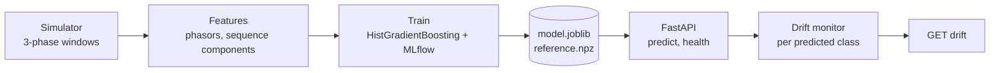
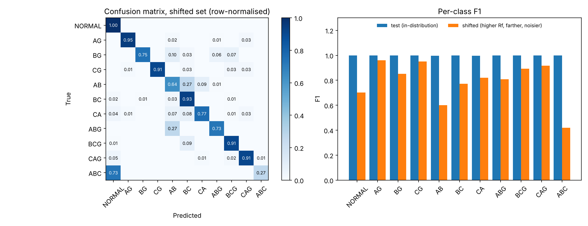

# grid-fault-service


A small end-to-end ML service for power-system protection: classify the type of a three-phase fault (or no fault) from a 60 ms window of relay measurements, serve it over an API, and watch for input drift in production.

It covers the whole loop on one problem: data generation, feature engineering, experiment tracking, serving with input validation, tests, containerisation, CI, and drift monitoring.

## Architecture



## Results

| Split | Accuracy | Macro F1 |
|---|---|---|
| Test (same distribution as training) | 0.999 | 0.999 |
| Shifted (higher fault resistance, farther faults, more noise) | 0.796 | 0.790 |



The in-distribution score is near-perfect because the simulator is clean and the features are physics-based, so it says little on its own. The shifted set is the informative number: most of the errors are high-resistance three-phase faults (ABC) read as normal load, because a balanced fault with a small voltage sag has no sequence-component signature.

## Quickstart

```bash
docker build -t grid-fault-service .        # trains the model during the build
docker run --rm -p 8000:8000 grid-fault-service
curl -X POST localhost:8000/predict -H 'Content-Type: application/json' -d @examples/ag_fault.json
```

```json
{"label":"AG","fault_detected":true,"confidence":1.0,"probabilities":{"NORMAL":0.0,"AG":1.0,"...":0.0}}
```

| Endpoint | Purpose |
|---|---|
| `GET /health` | 200 when the model is loaded, 503 otherwise |
| `POST /predict` | body `{"window": [[...240 floats] x 6]}` in per-unit; channel order Va, Vb, Vc, Ia, Ib, Ic |
| `GET /drift` | compare recent inputs with the training distribution, per predicted class |
| `POST /drift/reset` | clear the drift buffer |

Invalid input (wrong channel count, wrong length, NaN, values beyond +/-100 pu) returns 422 with a message saying what is wrong. Interactive docs at `/docs`.

The model is trained inside the Docker build rather than committed, so the image is reproducible and the model always matches the image's library versions. A multi-stage build keeps MLflow and matplotlib out of the runtime image.

## Drift monitoring

Every `/predict` call stores the window's feature vector (not the raw waveform) in a rolling per-class buffer. `GET /drift` compares each buffer with the training distribution of that class.

- **Per predicted class.** A healthy network sends mostly normal windows, while the training set is class-balanced. Comparing the whole stream with the training set would alarm on that change in class mix alone. Within a class the question is narrower: do the windows the model calls "AG" still look like the AG windows it learned from?
- **Two tests must agree** for a feature to count as drifted: Population Stability Index above 0.2 and a two-sample Kolmogorov-Smirnov p-value below 0.001. A class is flagged when at least 3 features drifted, and only once it has 100 buffered windows.
- **Checked against simulation** (true labels as buckets): across 8 in-distribution runs there was not a single drifted feature in any class, and all 4 shifted runs flagged every class.

Reproduce it against a running service (about a minute, it sends ~2,600 requests):

```bash
PYTHONPATH=src python -m gridfault.demo_drift
```

Output from a real run (rows with fewer than 100 windows are not evaluated and are omitted):

```text
Phase 1: in-distribution traffic
  status=ok  drift_detected=False  buffered=1320
    NORMAL: n=120  drifted_features=0   max_psi=0.0
        AG: n=120  drifted_features=0   max_psi=0.0
       ...  (all 11 classes: 0 drifted features)

Phase 2: shifted traffic (higher fault resistance, farther faults, more noise)
  status=ok  drift_detected=True  buffered=1320
    NORMAL: n=233  drifted_features=29  max_psi=2.66
        AG: n=110  drifted_features=28  max_psi=8.283
        AB: n=139  drifted_features=31  max_psi=8.283
       ...
```

In phase 2 the NORMAL bucket holds 233 windows although only 120 were truly normal, so roughly 110 shifted faults ended up there as misread normal load, the failure shown in the results above. Several fault classes (BG, CA, ABC) fell below 100 windows because their members were misclassified, so they were not evaluated. Drift detection and the accuracy drop point at the same problem.

## Develop

```bash
pip install -r requirements-dev.txt
PYTHONPATH=src pytest -q        # 41 tests: simulator physics, features, API, drift
ruff check . && ruff format --check .
```

CI (`.github/workflows/ci.yml`) runs lint, tests, then builds the image and smoke-tests the running container with real `/predict` and `/drift` calls.

Train and track experiments (needs the extra training dependencies):

```bash
pip install -r requirements-train.txt
PYTHONPATH=src python -m gridfault.train
mlflow ui --backend-store-uri sqlite:///mlflow.db
```

## Layout

- `src/gridfault/simulate.py`: synthetic generator for 3-phase voltage/current windows (11 classes: normal plus 10 fault types). Varies fault resistance, distance, inception time, DC offset, harmonics and noise; includes load steps as hard negatives.
- `src/gridfault/features.py`: fundamental phasors, symmetrical components (zero/positive/negative sequence), pre/post-fault RMS ratios.
- `src/gridfault/train.py`: baseline training, MLflow tracking, saves `artifacts/model.joblib` and the drift reference.
- `src/gridfault/model.py`: fit, save and load helpers.
- `src/gridfault/api.py`: FastAPI service with Pydantic-validated input.
- `src/gridfault/drift.py`: PSI and KS drift monitor.
- `src/gridfault/demo_drift.py`: drift demo against a running service.
- `src/gridfault/make_example.py`: regenerates `examples/*.json`.

## Limitations

- **The data is synthetic and simplified:** single source, no transformers, no CT saturation, no network topology. It is not a substitute for EMT simulation or field recordings, and the model's scores say nothing about real relays.
- **The shifted split is one hand-picked shift**, not a robustness study. The drift thresholds were checked against that same shift: its sensitivity to mild or gradual drift is not measured.
- **Drift strata use the model's own predictions**, so misclassified windows land in the wrong bucket (visible above). That still tends to show up as drift, but it is not a clean per-true-class test.
- **The drift buffer lives in process memory.** It resets on restart and is per worker. A production setup would export the statistics to a shared metrics store.
- No authentication or rate limiting on the API.

## License

MIT, see `LICENSE`.
